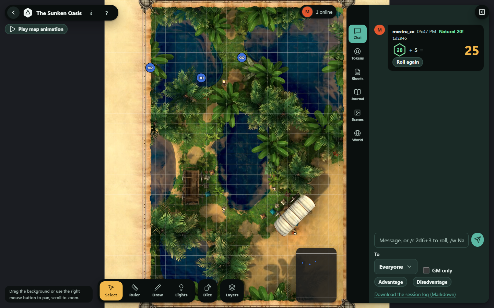

# Tutorial: your first session

About ten minutes, from an empty installation to rolling dice with a friend. Install OpenVTT first: [getting-started.md](getting-started.md).

A short animation of play is in [`site/assets/demo.webm`](../site/assets/demo.webm) (also shown in the README as a GIF).

## 1. Create a world

1. Sign in. On **Your worlds**, type a **World name** and choose a **Rules system** (Generic is the simplest; D&D 5e SRD adds sheets and a compendium).
2. Choose **Create world**, then **Open**.

The first time, a short tour points at the main areas.

## 2. Make a scene

1. Open the **Scenes** tab.
2. Under **New scene**, give it a **Name** and pick a **Map image or video** (PNG, JPG, WebP, WebM or MP4). With no file you can set a plain background size instead.
3. Choose **Create scene**. The scene you want players to see must be shown to them: use **Show to players** on it (the active scene is marked "shown to players").
4. In **Scene settings**, choose the **Grid** (square, hex or none) and the **Distance per cell**. If the grid does not line up with the picture, use **Adjust grid on the map**.

Maps from Dungeon Alchemist come with their grid, walls, doors and lights: see [tutorial-importing-maps.md](tutorial-importing-maps.md).

## 3. Add a token

1. Open the **Tokens** tab, type a **Name** and choose **Add token**.
2. Click it in the token list, then drag it on the map. It snaps to the grid. Arrow keys move the selected token one cell, `[` and `]` rotate it, `Delete` removes it.
3. In the token's settings you can set its size, picture, hit points, conditions and **Hidden from players**. Hidden tokens are never sent to players' browsers.
4. **Who can move it** lets you give a player control of their own token.

Pan with the right mouse button or by dragging the background, zoom with the scroll wheel. Press `?` for every shortcut.

## 4. Invite a player

1. Open the **World** tab, create an invite link, choose how long it lasts and how many people can use it, and copy it.
2. Send it. The player opens it, signs in or creates an account, picks a display name and color, and appears at the table. See [getting-started.md](getting-started.md#inviting-players) for roles.

## 5. Roll dice

In the **Chat** tab type:

| Command | Effect |
|---|---|
| `/r 2d6+3` | Roll for everyone (the server rolls, so results are trustworthy) |
| `/r 1d20 adv` | Roll with advantage (`dis` for disadvantage) |
| `/gr 1d20` | Roll only the game master sees |
| `/w Name message` | Whisper to one person |

Press `D` to open the dice tray and click dice instead of typing.

## 6. Run a fight

Select tokens and add them to the **Initiative** order with a score; the game master advances the turn and round. Players see the order without hidden tokens. Use the **Ruler** (`R`) to measure distances in squares, feet or meters.

## 7. Add a character sheet

In the **Sheets** tab, create a **Character** or **NPC** sheet, set its **Owner** so the player can edit it, and link a token to it from the token's **Linked sheet**. Sheet layouts come from the rules system and can be edited without code: [creating-a-system.md](creating-a-system.md).

## Next

- [Importing a map](tutorial-importing-maps.md)
- [Lighting and fog of war](tutorial-lighting-and-fog.md)
- [Backups](backup-and-restore.md): set them up before the campaign grows.
